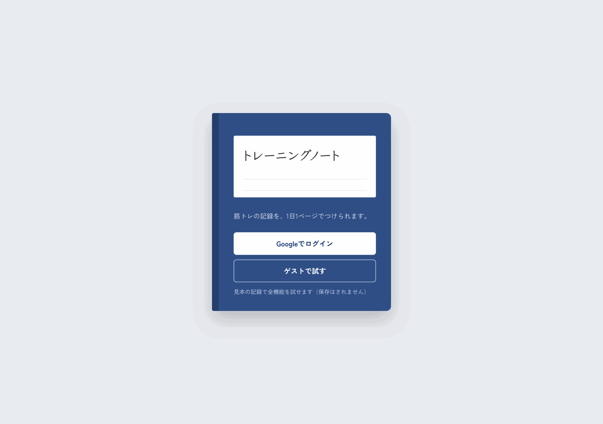
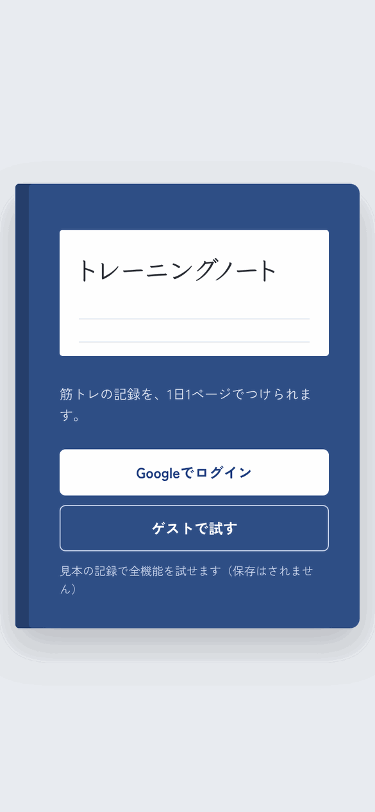

# トレーニングノート

筋トレの記録を、**紙のトレーニングノート**のように1日1ページでつけられるWebアプリです。
よくやる種目の組み合わせを「メニュー」として登録しておけば、ボタン1つでまとめて書き込めます。
Googleアカウントでログインするとクラウドに保存され、どの端末からでも同じノートを開けます。ログインせずに **「ゲストで試す」** から見本の記録で全機能を試すこともできます。

**公開URL：** [training-tracker-three.vercel.app](https://training-tracker-three.vercel.app)（ログイン画面の「ゲストで試す」からすぐ触れます）

<p>
  
  
</p>

> スクリーンショットはゲストモード（見本の記録）で撮影しています。

---

## デザインのコンセプト

ジムでトレーニングを記録する人が使う、紙のノートを土台にしました。

- **1日が1ページ**：罫線の上に記録が並び、ページの左には赤い余白線。ページの下が「書き込み欄」で、開いている日に記録を書き込みます
- **手書き風の文字**：日付と記録は、鉛筆で書いたような書体（Klee One）で表示しています
- **ボールペンの青**：ボタンや選んでいる日など、操作に関わるものだけを青にしています。カレンダーで表示中の日には、ペンで丸をつけたような印が付きます
- **1日の合計**：ページの最後に、種目数・セット数・総重量（重さ × 回数 × セット）を書き添えます

| 色 | 用途 |
|---|---|
| `#E9ECF0` | 背景（机） |
| `#D6E2EF` | 罫線 |
| `#E7A3A3` | 余白線 |
| `#2747A0` ボールペンの青 | ボタン・選択中の日・合計 |
| `#2A2D34` | 文字（鉛筆） |

文字は、記録部分に **Klee One**、それ以外に **Zen Kaku Gothic New** を使っています（どちらもアプリに同梱）。

---

## 画面

### ログイン
ノートの表紙をイメージした画面です。Googleでログインするか、ゲストモードで試せます。

| PC | スマホ |
|---|---|
|  |  |

### 1日のページ
◀▶で前後の日へ、「今日へ」で今日のページへ移動します。ページの下の欄から種目・重さ・回数・セットを書き込みます。スマホでは1つの記録を2行（種目／重さ・回数）で書きます。

| PC | スマホ |
|---|---|
|  |  |

### 書き込み欄（スマホ）
種目と重さは一覧から選べて、一覧にない種目・重さは自由に入力できます（入力したものは次から一覧に出ます）。メニューを選べば、登録した種目をまとめて書き込めます。


### カレンダー
記録がある日に点が付き、日付を押すとその日のページを開きます。その月に何日トレーニングしたかも表示します。

| PC | スマホ |
|---|---|
|  |  |

### メニュー
「胸の日」「脚の日」のように、種目・重さ・回数・セット数の組み合わせを登録しておけます。

| PC | スマホ |
|---|---|
|  |  |

---

## 使用技術

| カテゴリ | 技術 |
|---|---|
| フロントエンド | React 19, Vite 7 |
| 言語 | JavaScript |
| スタイル | プレーンCSS（CSS変数・メディアクエリでレスポンシブ対応） |
| アイコン | lucide-react |
| フォント | Klee One、Zen Kaku Gothic New（@fontsource で同梱） |
| 認証 | Firebase Authentication（Googleログイン） |
| DB | Cloud Firestore（セキュリティルールでユーザーごとにアクセス制御） |
| デプロイ | Vercel |

---

## 主な機能

- 1日1ページでの記録（追加・削除）と、1日の合計（種目数・セット数・総重量）
- 前後の日・今日・カレンダー・最近の記録の目次から、見たい日のページへ移動
- 種目・重さの候補を自動で増やす（新しく入力したものは次回から選択肢に出る）
- カレンダー（記録がある日に印、月のトレーニング日数）
- メニューの作成・編集・削除と、メニューからのまとめ書き込み
- Googleログインでクラウドに保存（どの端末からでも同じノート）
- ゲストモード（見本の記録で全機能を試せる。保存はしない）
- ログインなしの頃にこの端末へ保存した記録を、ログイン後にアカウントへ移せる
- スマホ対応のレスポンシブUI

---

## 設計のポイント

### コンポーネント分割
画面を役割ごとのコンポーネントに分け、データの読み書きは `useNotebook` フック、保存先の切り替えは `AuthContext` にまとめています。

```
src/
├── App.jsx                     # ログイン前はログイン画面、後はノート
├── Notebook.jsx                # ノート全体（表示中の日・メニュー編集の状態）
├── auth/
│   └── AuthContext.jsx         # ログイン状態と保存先（repo）の切り替え
├── components/
│   ├── LoginPage.jsx           # ノートの表紙のようなログイン画面
│   ├── DayPage.jsx             # 1日分のページ（記録と合計）
│   ├── EntryForm.jsx           # ページ下の書き込み欄
│   ├── MonthCalendar.jsx       # 月のカレンダー
│   ├── RecentDays.jsx          # 最近の記録（目次）
│   ├── PresetManager.jsx       # メニューの作成・編集
│   └── ImportBanner.jsx        # この端末の記録をアカウントに移す案内
├── data/
│   ├── firestoreRepo.js        # Firestore への保存
│   ├── guestRepo.js            # ゲスト用（メモリ上の見本データ）
│   └── localData.js            # 以前の localStorage のデータを読む
├── hooks/
│   └── useNotebook.js          # 記録・メニュー・候補の読み込みと保存
└── lib/
    ├── firebase.js             # Firebase の初期化
    ├── dates.js                # 日付の計算・表示（ローカル時刻）
    └── sample.js               # 見本の記録
```

### 保存先を差し替えられるリポジトリ層
データの読み書きを `data/firestoreRepo.js`（Firestore）と `data/guestRepo.js`（メモリ上の見本データ）に分け、どちらも同じ API（`load` / `addTrainings` / `savePreset` など）を持たせています。ログイン方法に応じて `AuthContext` がどちらかを渡すので、画面側は保存先の違いを意識せずに同じコードで動きます。

```js
// ログイン方法に応じて保存先を切り替える（AuthContext）
const repo = useMemo(() => {
  if (guestRepo) return guestRepo;                  // ゲスト → 見本データ
  if (user) return createFirestoreRepo(user.uid);   // Googleログイン → Firestore
  return null;
}, [guestRepo, user]);
```

### 画面はすぐ更新し、保存は裏で行う
`useNotebook` は、書き込みや削除をするとまず画面を更新し、そのあと保存先に書き込みます（楽観的更新）。保存に失敗したときは画面の上にメッセージを出します。

### 以前の記録をアカウントに移す
ログインなしで使っていた頃の記録は localStorage に残っています。初めてログインしたときに件数を表示して「アカウントに移す」かどうかを聞き、移すときは記録の id をそのまま使うので、何度押しても二重には登録されません。

### Firestore セキュリティルールでユーザーごとにデータを分離
データは `users/{uid}/trainings` のようにユーザーごとのパスに保存し、セキュリティルールで「ログイン中の本人のパスだけ読み書きできる」ようにしています。記録は日付・種目名・数値の形もルール側でチェックしています（`firestore.rules`）。

### 罫線と記録の高さをそろえる
罫線は CSS の `linear-gradient` で 40px ごとに引き、記録の1行も同じ 40px にしています。スマホで1つの記録を2行にするときも 80px（罫線2本分）にして、文字が罫線からずれないようにしています。

### useMemo による派生データの計算
「日付ごとにまとめた記録」「記録がある日の一覧」は `useMemo` でまとめ、記録が変わったときだけ計算し直すようにしています。

### 設定がなくても落ちない作り
Firebase の環境変数が未設定のときは、Googleログインを無効にしてゲストモードだけ使えるようにしています。

### カレンダーの曜日合わせ
月の1日が何曜日かを求めて先頭に空きマスを入れ、日付が正しい曜日の列に並ぶようにしています。土日の色分けも同じ計算から決めています。

### 入力エラーは画面の中で伝える
`alert()` は使わず、書き込み欄やメニュー編集の下に「何が足りないか」をメッセージで表示します。

### アクセシビリティ
- アイコンだけのボタン（◀▶・×など）には `aria-label` を付けています
- カレンダーの日付ボタンは「10月27日（3種目）」のように読み上げられます
- キーボード操作時はフォーカスの枠を表示します

---

## ローカルでの動作確認

```bash
git clone https://github.com/yusuketoyoda0716-hash/training-tracker.git
cd training-tracker
npm install
cp .env.example .env   # .env に Firebase の設定値を記入（未記入でもゲストモードは動きます）
npm run dev
```

### Firebase のセットアップ

1. [Firebase コンソール](https://console.firebase.google.com/) でプロジェクトを作成
2. 「Authentication」→「ログイン方法」で **Google** を有効化
3. 「Authentication」→「設定」→「承認済みドメイン」にデプロイ先のドメインを追加
4. 「Firestore Database」を作成し、「ルール」タブに `firestore.rules` の内容を貼り付けて公開
5. 「プロジェクトの設定」→「マイアプリ」でウェブアプリを追加し、表示された設定値を `.env`（Vercel では Environment Variables）に記入

```
VITE_FIREBASE_API_KEY=
VITE_FIREBASE_AUTH_DOMAIN=
VITE_FIREBASE_PROJECT_ID=
VITE_FIREBASE_STORAGE_BUCKET=
VITE_FIREBASE_MESSAGING_SENDER_ID=
VITE_FIREBASE_APP_ID=
```

### データ構成（Firestore）

```
users/{uid}/trainings/{id}   date, name, weight, reps, sets, order, createdAt
users/{uid}/presets/{id}     name, items[{ exercise, weight, reps, sets }], updatedAt
users/{uid}/meta/lists       exercises[], weights[]（種目と重さの候補）
```

---

## 今後の改善候補

- 種目ごとの重さの推移グラフ
- 記録の編集
- データのエクスポート（CSV）
