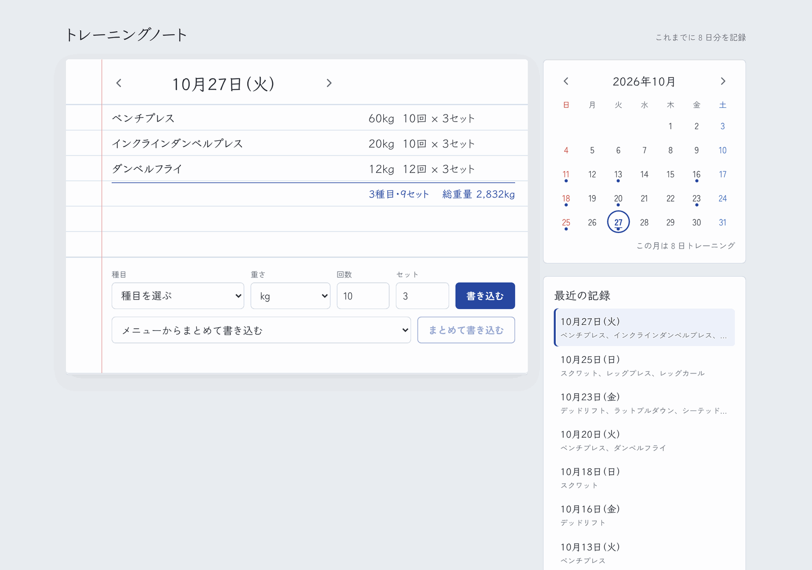
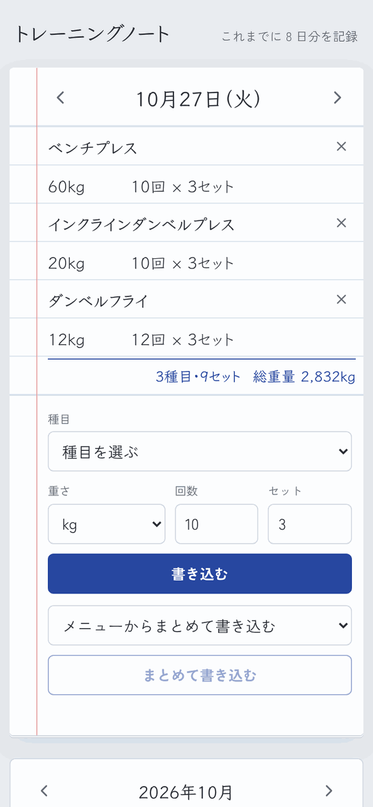
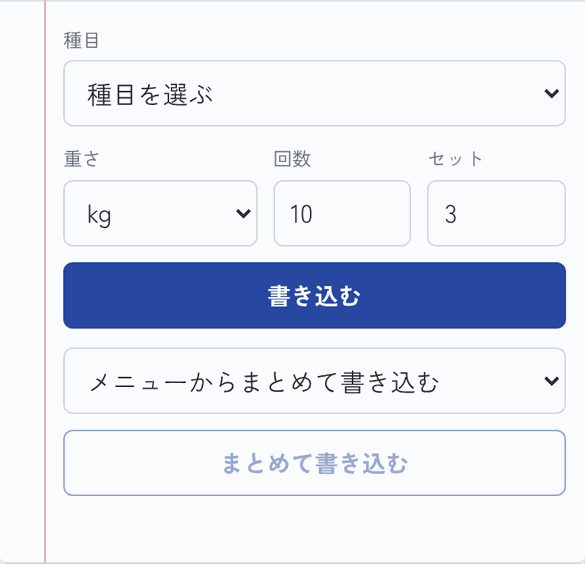
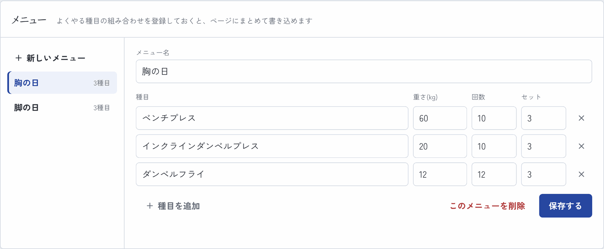
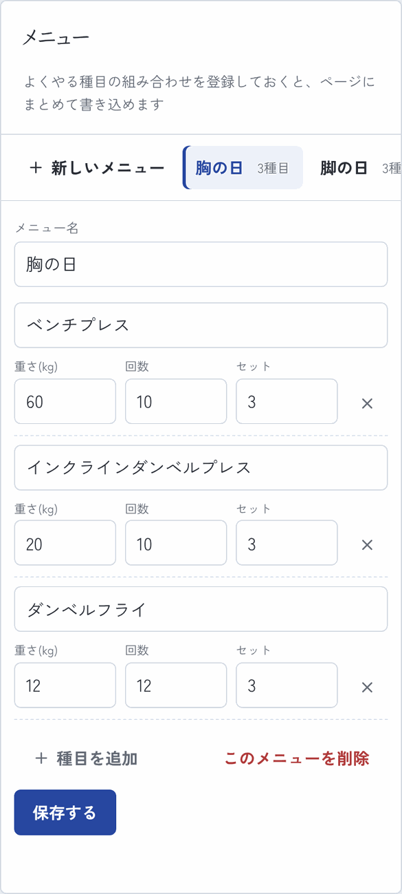

# トレーニングノート

筋トレの記録を、**紙のトレーニングノート**のように1日1ページでつけられるWebアプリです。
よくやる種目の組み合わせを「メニュー」として登録しておけば、ボタン1つでまとめて書き込めます。

**公開URL：** [training-tracker-three.vercel.app](https://training-tracker-three.vercel.app)（ログイン不要。初めて開いたときは「見本の記録を入れる」で中身を試せます）

<p>
  
  
</p>

> スクリーンショットは見本の記録で撮影しています。

---

## デザインのコンセプト

ジムでトレーニングを記録する人が使う、紙のノートを土台にしました。

- **1日が1ページ**：罫線の上に記録が並び、ページの左には赤い余白線。ページの下が「書き込み欄」で、開いている日に記録を書き込みます
- **手書き風の文字**：日付と記録は、鉛筆で書いたような書体（Klee One）で表示しています
- **ボールペンの青**：ボタンや選んでいる日など、操作に関わるものだけを青にしています。カレンダーで表示中の日には、ペンで丸をつけたような印が付きます
- **1日の合計**：ページの最後に、種目数・セット数・総重量（重さ × 回数 × セット）を書き添えます

| 色 | 用途 |
|---|---|
| `#E9ECF0` | 背景（机） |
| `#D6E2EF` | 罫線 |
| `#E7A3A3` | 余白線 |
| `#2747A0` ボールペンの青 | ボタン・選択中の日・合計 |
| `#2A2D34` | 文字（鉛筆） |

文字は、記録部分に **Klee One**、それ以外に **Zen Kaku Gothic New** を使っています（どちらもアプリに同梱）。

---

## 画面

### 1日のページ
◀▶で前後の日へ、「今日へ」で今日のページへ移動します。ページの下の欄から種目・重さ・回数・セットを書き込みます。スマホでは1つの記録を2行（種目／重さ・回数）で書きます。

| PC | スマホ |
|---|---|
|  |  |

### 書き込み欄（スマホ）
種目と重さは一覧から選べて、一覧にない種目・重さは自由に入力できます（入力したものは次から一覧に出ます）。メニューを選べば、登録した種目をまとめて書き込めます。



### カレンダー
記録がある日に点が付き、日付を押すとその日のページを開きます。その月に何日トレーニングしたかも表示します。

| PC | スマホ |
|---|---|
|  |  |

### メニュー
「胸の日」「脚の日」のように、種目・重さ・回数・セット数の組み合わせを登録しておけます。

| PC | スマホ |
|---|---|
|  |  |

---

## 使用技術

| カテゴリ | 技術 |
|---|---|
| フロントエンド | React 19, Vite 7 |
| 言語 | JavaScript |
| スタイル | プレーンCSS（CSS変数・メディアクエリでレスポンシブ対応） |
| アイコン | lucide-react |
| フォント | Klee One、Zen Kaku Gothic New（@fontsource で同梱） |
| データ保存 | localStorage（ブラウザ内に保存） |
| デプロイ | Vercel |

---

## 主な機能

- 1日1ページでの記録（追加・削除）と、1日の合計（種目数・セット数・総重量）
- 前後の日・今日・カレンダー・最近の記録の目次から、見たい日のページへ移動
- 種目・重さの候補を自動で増やす（新しく入力したものは次回から選択肢に出る）
- カレンダー（記録がある日に印、月のトレーニング日数）
- メニューの作成・編集・削除と、メニューからのまとめ書き込み
- 初めて開いたときに見本の記録を入れられるボタン
- データの自動保存（localStorage）
- スマホ対応のレスポンシブUI

---

## 設計のポイント

### コンポーネント分割
画面を役割ごとのコンポーネントに分け、保存するデータと処理は `App.jsx` にまとめて props で渡しています。

```
src/
├── App.jsx                     # データと処理をまとめる親コンポーネント
├── components/
│   ├── DayPage.jsx             # 1日分のページ（記録と合計）
│   ├── EntryForm.jsx           # ページ下の書き込み欄
│   ├── MonthCalendar.jsx       # 月のカレンダー
│   ├── RecentDays.jsx          # 最近の記録（目次）
│   └── PresetManager.jsx       # メニューの作成・編集
├── hooks/
│   └── useLocalStorage.js      # state と localStorage を同期するカスタムHook
└── lib/
    ├── dates.js                # 日付の計算・表示（ローカル時刻）
    └── sample.js               # 見本の記録
```

### カスタムHook `useLocalStorage`
`useState` と同じ使い方で、値が変わるたびに自動で localStorage に保存されるHookを作りました。保存データが壊れていたり容量が足りなかったりしても、アプリが落ちないように try/catch で守っています。以前のバージョンと同じ保存キーを使っているので、これまでの記録はそのまま読み込めます。

```js
// useState と同じ感覚で使える
const [trainings, setTrainings] = useLocalStorage("trainings", []);
```

### 罫線と記録の高さをそろえる
罫線は CSS の `linear-gradient` で 40px ごとに引き、記録の1行も同じ 40px にしています。スマホで1つの記録を2行にするときも 80px（罫線2本分）にして、文字が罫線からずれないようにしています。

### useMemo による派生データの計算
「日付ごとにまとめた記録」「記録がある日の一覧」は `useMemo` でまとめ、記録が変わったときだけ計算し直すようにしています。

### カレンダーの曜日合わせ
月の1日が何曜日かを求めて先頭に空きマスを入れ、日付が正しい曜日の列に並ぶようにしています。土日の色分けも同じ計算から決めています。

### 入力エラーは画面の中で伝える
`alert()` は使わず、書き込み欄やメニュー編集の下に「何が足りないか」をメッセージで表示します。

### アクセシビリティ
- アイコンだけのボタン（◀▶・×など）には `aria-label` を付けています
- カレンダーの日付ボタンは「10月27日（3種目）」のように読み上げられます
- キーボード操作時はフォーカスの枠を表示します

---

## データの保存について

データはブラウザの localStorage に保存しています。サーバーには送らないので、ログインなしですぐ使えます。その代わり、記録は使っている端末・ブラウザの中だけに残ります（別の端末とは共有されません）。

---

## ローカルでの動作確認

```bash
git clone https://github.com/yusuketoyoda0716-hash/training-tracker.git
cd training-tracker
npm install
npm run dev
```

---

## 今後の改善候補

- 種目ごとの重さの推移グラフ
- 記録の編集
- データのエクスポート／インポート（端末の移行用）
