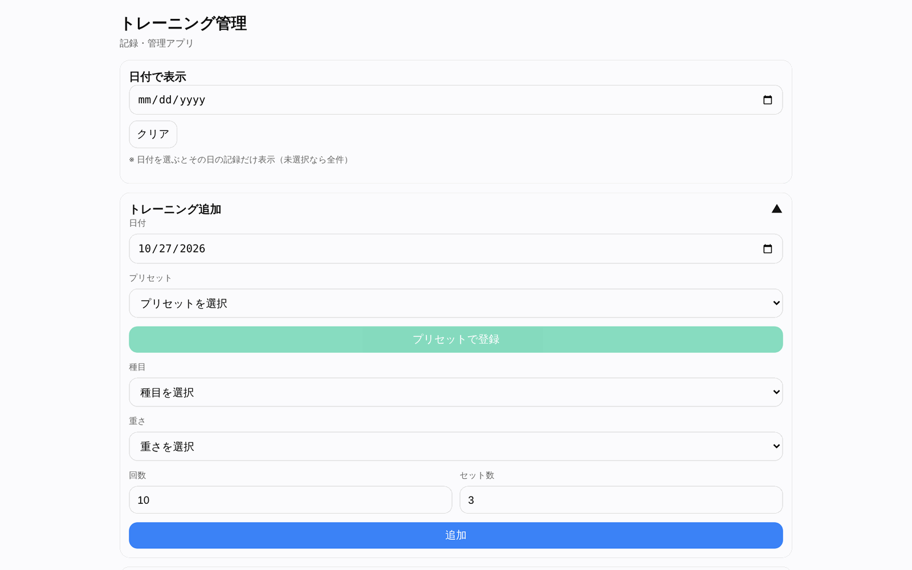
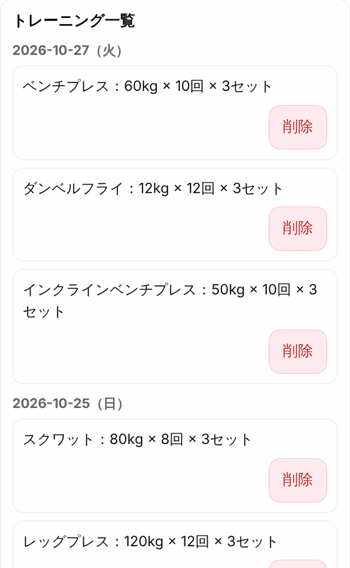
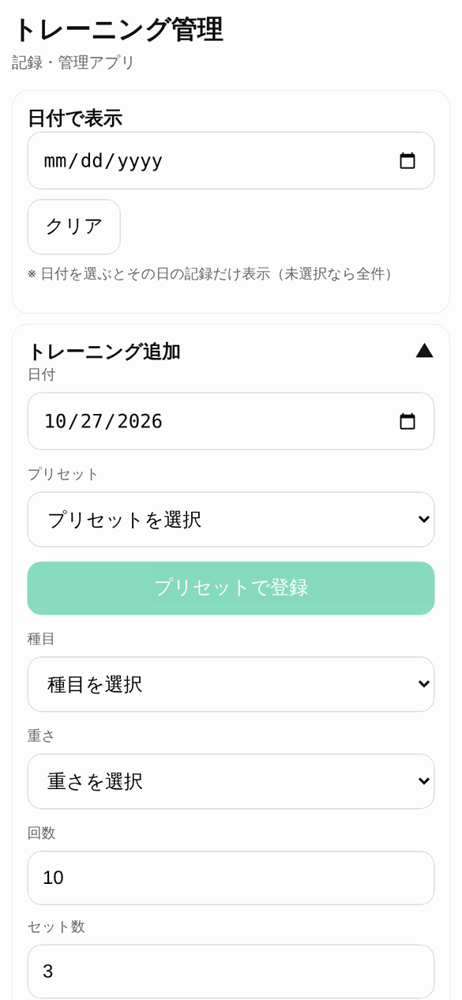
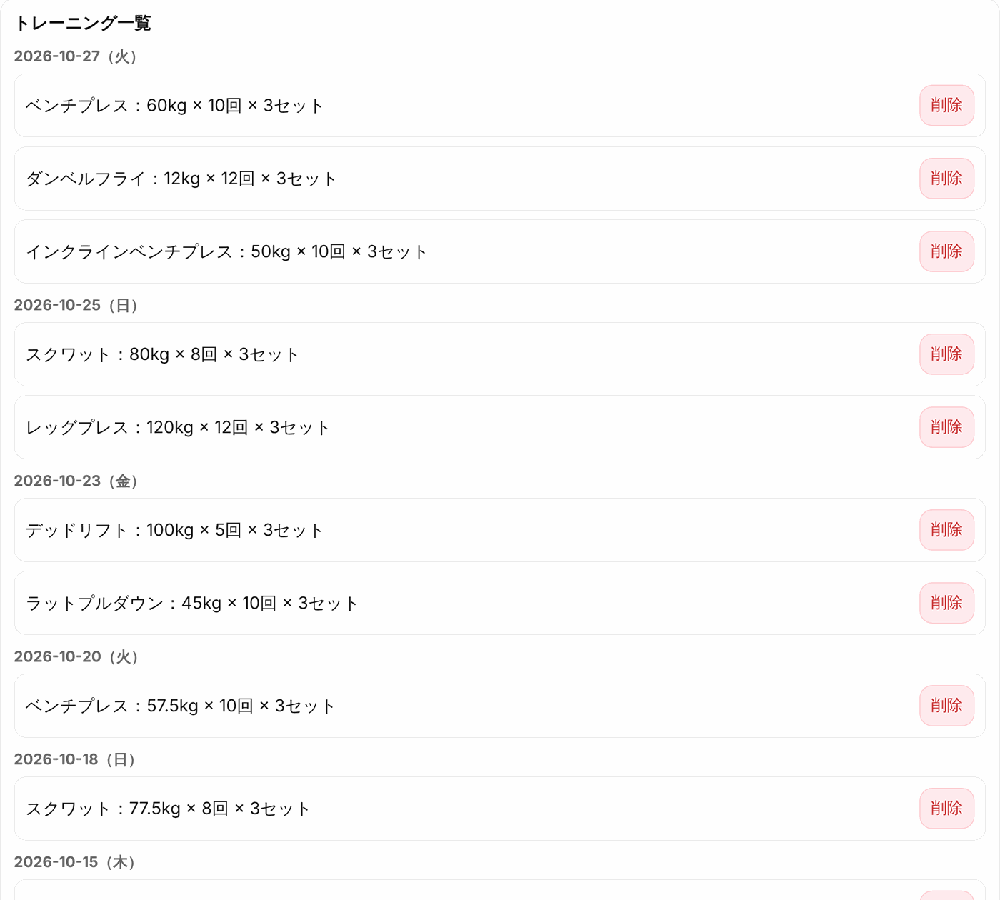
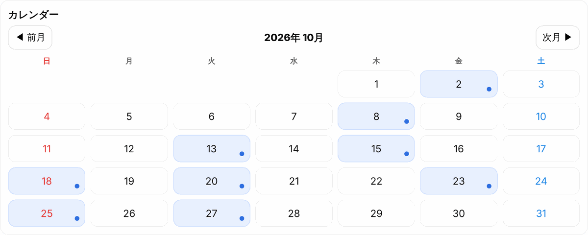
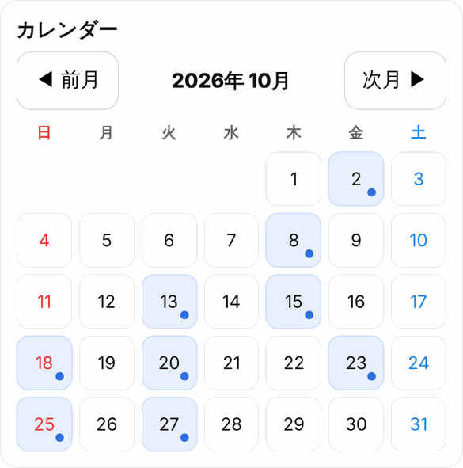
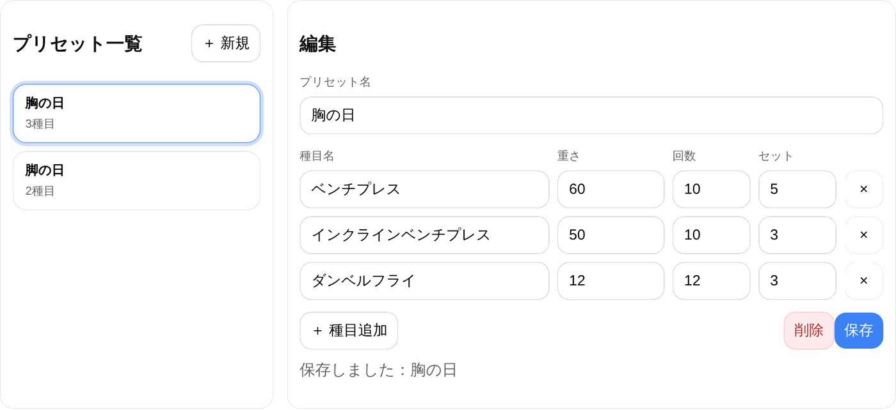
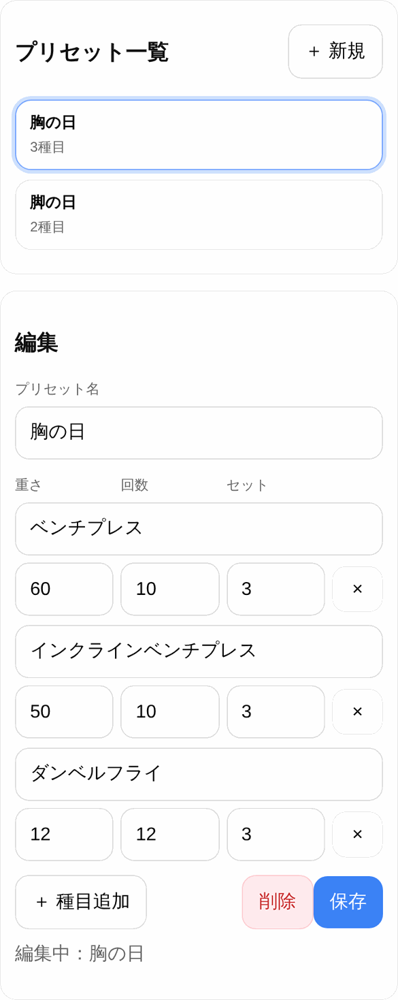

# Training Tracker

筋トレの記録をつけて、日付やカレンダーから振り返れるWebアプリです。
よくやるメニューを「プリセット」として登録しておけば、ボタン1つでまとめて記録できます。

**公開URL：** [training-tracker-three.vercel.app](https://training-tracker-three.vercel.app)（ログイン不要ですぐ使えます）

<p>
  
  
</p>

> スクリーンショットはサンプルデータで撮影しています。

---

## 画面

### トレーニング追加
日付・種目・重さ・回数・セット数を選んで記録します。種目と重さは一覧から選べて、一覧にないものは自由入力もできます（入力した種目・重さは次回から一覧に出ます）。

| PC | スマホ |
|---|---|
|  |  |

### トレーニング一覧
記録を日付ごとにまとめて新しい順に表示します。日付を選ぶとその日の記録だけに絞り込めます。

| PC | スマホ |
|---|---|
|  |  |

### カレンダー
記録がある日に印が付きます。日付をタップするとその日の記録を表示します。

| PC | スマホ |
|---|---|
|  |  |

### プリセット管理
「胸の日」「脚の日」のように、種目・重さ・回数・セット数の組み合わせを登録しておけます。

| PC | スマホ |
|---|---|
|  |  |

---

## 使用技術

| カテゴリ | 技術 |
|---|---|
| フロントエンド | React 19, Vite 7 |
| 言語 | JavaScript |
| スタイル | プレーンCSS（CSS変数・メディアクエリでレスポンシブ対応） |
| データ保存 | localStorage（ブラウザ内に保存） |
| デプロイ | Vercel |

---

## 主な機能

- トレーニングの追加・削除
- 種目・重さの候補を自動で増やす（新しく入力したものは次回から選択肢に出る）
- 日付ごとにまとめた一覧表示・日付での絞り込み
- カレンダー表示（月切り替え、記録がある日に印）
- プリセットの作成・編集・削除と、プリセットからの一括登録
- データの自動保存（localStorage）
- スマホ対応のレスポンシブUI

---

## 設計のポイント

### コンポーネント分割
画面を役割ごとのコンポーネントに分け、状態（state）と処理は `App.jsx` にまとめて props で渡しています。

```
src/
├── App.jsx                     # 状態と処理をまとめる親コンポーネント
├── components/
│   ├── Header.jsx              # タイトル
│   ├── DateFilter.jsx          # 日付での絞り込み
│   ├── TrainingForm.jsx        # トレーニング追加フォーム
│   ├── PresetManager.jsx       # プリセットの作成・編集
│   ├── TrainingList.jsx        # 日付ごとの一覧
│   └── Calendar.jsx            # 月カレンダー
└── hooks/
    └── useLocalStorage.js      # state と localStorage を同期するカスタムHook
```

### カスタムHook `useLocalStorage`
`useState` と同じ使い方で、値が変わるたびに自動で localStorage に保存されるHookを作りました。保存データが壊れていたり容量が足りなかったりしても、アプリが落ちないように try/catch で守っています。

```js
// useState と同じ感覚で使える
const [trainings, setTrainings] = useLocalStorage("trainings", []);
```

### useMemo による派生データの計算
「日付ごとのグループ」「カレンダーの各日に記録があるか」など、記録一覧から計算する値は `useMemo` でまとめ、記録や選択日が変わったときだけ計算し直すようにしています。

### カレンダーの曜日合わせ
月の1日が何曜日かを求めて先頭に空きマスを入れ、日付が正しい曜日の列に並ぶようにしています。土日の色分けも同じ計算から決めています。

### スマホ向けの調整
768px以下では、フォームを1列に並べたり、一覧の削除ボタンを下に回したり、プリセット編集を2行に分けたりして、指で操作しやすくしています。

---

## データの保存について

データはブラウザの localStorage に保存しています。サーバーには送らないので、ログインなしですぐ使えます。その代わり、記録は使っている端末・ブラウザの中だけに残ります（別の端末とは共有されません）。

---

## ローカルでの動作確認

```bash
git clone https://github.com/yusuketoyoda0716-hash/training-tracker.git
cd training-tracker
npm install
npm run dev
```

---

## 今後の改善候補

- 種目ごとの重さの推移グラフ
- 記録の編集
- データのエクスポート／インポート（端末の移行用）
